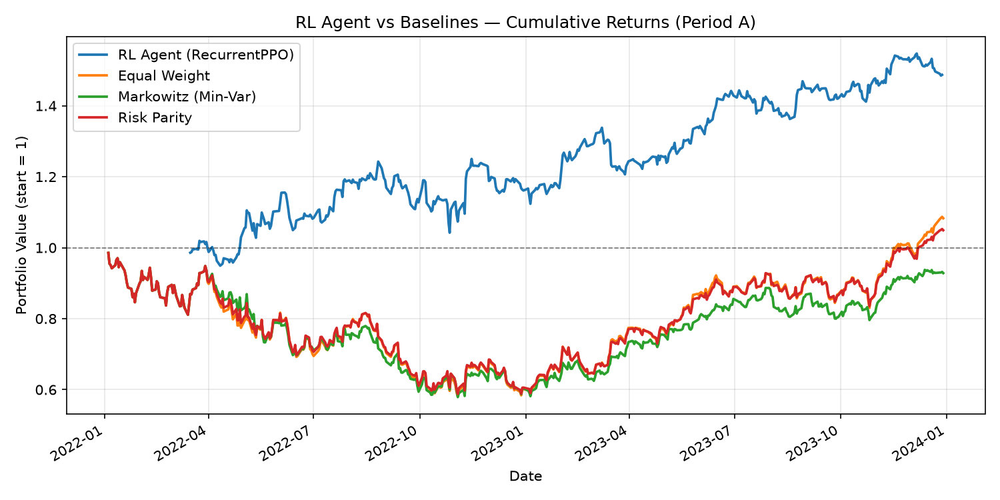

# RL Portfolio Management (IE 622 Seminar)

[](https://github.com/Parakh20/ie622-rl-portfolio-seminar/actions/workflows/ci.yml)
[](LICENSE)

A reinforcement-learning approach to single-asset signal trading using a recurrent
PPO agent (LSTM policy), benchmarked against classical portfolio baselines
(equal-weight, Markowitz minimum-variance, risk parity). Per-asset RL signals
are combined into an equal-weighted portfolio and compared against the
baselines on the same asset universe and held-out test period. The agent is
trained independently per ticker on a 20-day rolling window of technical
features and a 3-action (short/flat/long) policy, with a reward that blends a
rolling Sharpe ratio, a drawdown penalty, a directional bonus, and a
transaction-cost penalty.

## Architecture

**Environment** (`envs/portfolio_env.py`): `PortfolioEnv` is a `gymnasium.Env`
wrapping a single asset's price series. The state is a 20-day window of 9
engineered features plus the current position (181-dim observation). The
action space is discrete: short (-1), flat (0), long (+1). At each step the
reward is:

```
reward = SHARPE_COEF * rolling_sharpe(30d)
       + DD_COEF * min(drawdown, 0)
       + direction_bonus
       - TRANSACTION_COST * |Δposition|
```

**Features** (`envs/features.py`): log-return, momentum (5/15/30-day, clipped),
RSI-14, rolling volatility (10/30-day), Bollinger %B, absolute 5-day momentum.

**Agent** (`agents/recurrent_ppo.py`): `RecurrentPPO` (`sb3_contrib`) with an
LSTM policy (`MlpLstmPolicy`, hidden size 128), trained for 300,000 timesteps
per ticker with `n_steps=252` (one trading year of truncated BPTT), entropy
coefficient linearly decayed 0.05 → 0.01 over training, and observation
normalization (`VecNormalize`, stats frozen at evaluation time). Full
hyperparameters and the rationale for each tuning change vs. the original
report are in [`results/tuning_notes.md`](results/tuning_notes.md).

**Baselines** (`baselines/baselines.py`): equal-weight, Markowitz
minimum-variance (SLSQP, 60-day lookback, rebalanced every 20 days), and
risk-parity (equal risk contribution, same lookback/rebalance schedule).

**Asset universe and backtest period** (`data/universe.py`): 5 equities —
AAPL, MSFT, GOOGL, AMD, INTC (Period A). Train: 2018-01-01 to 2021-12-31.
Test: 2022-01-01 to 2023-12-31. A second equity split (Period B) and a
crypto universe/period are defined for extension but not run in the
results below.

## Quick start

Requires Python 3.11+.

```bash
git clone https://github.com/Parakh20/ie622-rl-portfolio-seminar.git
cd ie622-rl-portfolio-seminar
python3 -m venv .venv
source .venv/bin/activate

# Optional: CPU-only PyTorch is much smaller than the default CUDA build
pip install torch==2.12.1 --index-url https://download.pytorch.org/whl/cpu

pip install -r requirements-dev.txt   # runtime deps + pytest
pytest                                # ~10 s, no network or training needed
```

`requirements.txt` holds the runtime dependencies only; `requirements-dev.txt`
adds `pytest`.

## Reproducing the results

```bash
# Train one ticker (saves model + VecNormalize stats to results/models/)
python scripts/train.py --ticker AAPL --period A

# Quick smoke run of the training loop (not the reported configuration)
python scripts/train.py --ticker AAPL --period A --timesteps 20000

# Train all 5 tickers used in the results below (300k timesteps each)
for t in AAPL MSFT GOOGL AMD INTC; do
    python scripts/train.py --ticker $t --period A
done

# Evaluate a single trained model on its test period
python scripts/evaluate.py --ticker AAPL --period A

# Full RL-vs-baselines comparison
# (writes results/backtest_summary.csv and results/backtest_comparison.png)
python scripts/backtest.py --tickers AAPL MSFT GOOGL AMD INTC --period A
```

Trained models are not committed; `results/models/` is created by
`scripts/train.py` and is gitignored.

**Data.** Prices are downloaded from Yahoo Finance via `yfinance` on first use
and cached as CSV in `data/raw/` (gitignored). To pre-fetch the whole universe:
`python data/download.py` (or `--tickers AAPL MSFT ...`). Because Yahoo data can
be revised, re-downloaded prices may differ slightly from those used for the
numbers below.

**Baseline-only demo (no RL).** `notebooks/baseline_comparison_demo.ipynb`
(executed, with outputs) and its script twin `python scripts/baseline_demo.py`
compare equal-weight, random-Dirichlet and inverse-volatility portfolios on
AAPL, MSFT, GOOGL, AMZN, TSLA (2020 to 2024) and write
`results/cumulative_returns.png`.

## Project structure

```
agents/        RecurrentPPO factory + hyperparameters, performance metrics
baselines/     equal-weight, Markowitz min-variance, risk-parity, buy-and-hold
envs/          PortfolioEnv (gymnasium) and feature engineering
data/          asset universe and train/test periods, yfinance download + cache
scripts/       train.py, evaluate.py, backtest.py, baseline_demo.py
notebooks/     baseline comparison walkthrough (executed)
tests/         fast pytest smoke tests on synthetic data
results/       final backtest table and figures, tuning notes
report/        LaTeX source and figures of the original seminar report
docs/          detailed project notes (design decisions, audit, tuning history)
```

## Tests

`pytest` runs 26 smoke tests in about 10 seconds using synthetic price series,
so no network access or trained models are needed. They cover environment
observation/action shapes, reward bookkeeping and episode termination, feature
bounds, baseline weights (long-only, summing to 1), metric sanity values, and
that the RecurrentPPO agent builds with the documented hyperparameters and
produces a valid action. CI runs the suite on Python 3.11 for every push and
pull request.

## Results

Test period: 2022-01-01 to 2023-12-31, equal-weighted across AAPL, MSFT,
GOOGL, AMD, INTC.

| Strategy | Ann. Return | Cumulative Return | Sharpe | Max Drawdown | Calmar |
|---|---|---|---|---|---|
| **RL Agent (RecurrentPPO)** | **24.9%** | **48.7%** | **1.06** | **-16.1%** | **1.54** |
| Equal Weight | 4.1% | 8.3% | 0.22 | -41.0% | 0.10 |
| Markowitz (Min-Var) | -3.7% | -7.2% | -0.06 | -41.2% | -0.09 |
| Risk Parity | 2.4% | 4.9% | 0.16 | -40.3% | 0.06 |

The RL agent outperforms every baseline on every metric over this period —
notably with roughly a third of the drawdown of the buy-and-hold-style
baselines, driven by the policy's ability to flatten or short rather than
hold a static allocation through the 2022 drawdown.



## License

[MIT](LICENSE) (c) 2026 Parakh Sharma
